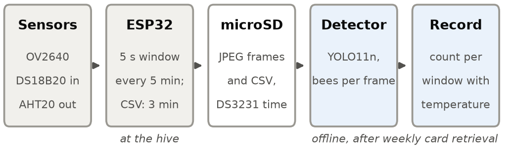
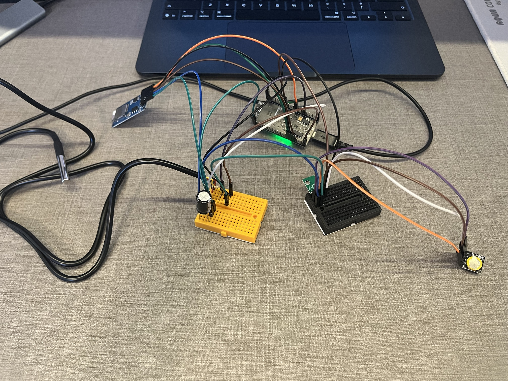

# Low-cost beehive monitoring

Station attached to a beehive that photographs the entrance and measures the
temperature without opening the box, without a network and, by design, on solar
power. On a computer, a detector counts the bees in each photo, and each count
sits next to the temperature of the same time.

Course IBM3118, Embedded Systems and IoT (Ibmec, 2026), Group 4: Igor Costa, Jorge
Alves, Ian Dias and Davi Ito. The full article, in English, is in
[`paper/beehive-monitoring.tex`](paper/beehive-monitoring.tex).

This project was developed in a repository shared with another project of the
course, and it was moved here with its commit history filtered. The commits
before the English translation have the files and comments in Portuguese. The
translation is in the commits that follow.



## What the article shows

The group has no hive, so the method was measured on public videos of real
hives, with every bee labelled by hand.

- **Detector.** On 3230 frames of three hives the model never saw, the YOLO11n
  found 83% of the bees (F1 0.83) and missed the count by 2.1 bees per frame.
- **Against background subtraction**, the classic method of Tu et al.: F1 0.88
  against 0.31 on the test videos. Background subtraction loses the bees that
  stand still, which become background.
- **Spread photos, not bursts.** On a 13 min hand-labelled recording and on a
  2 h YouTube video, one photo every 10 s estimated the bees of each 5 min period
  within half a bee. One 10 s burst per period missed by 2 to 3.

The article also explains why the error changes from hive to hive, what the count
measures (occupancy of the entrance, not traffic) and how much energy the
station should use.

## The station

ESP32-WROVER-DEV with the OV2640 camera, a waterproof DS18B20 inside the hive,
an AHT20 outside, a DS3231 clock with its own battery and a microSD reader, on two
mini breadboards. The firmware wakes every 10 s, takes the photo, writes it to the
card under the DS3231 time, appends a CSV line with the temperatures every 5 min
and goes back to deep sleep; it stays awake 0.6 s per photo. Every start that is
not a wake from sleep goes to an event file with its cause, and a watchdog
restarts a wake that hangs. The solar supply was sized, not built: it is future
work, as is the installation at a real hive.



The step-by-step assembly, with a test for each module, is in
[`docs/assembly.md`](docs/assembly.md), and each decision, with its reason, in
[`docs/design-decisions.md`](docs/design-decisions.md).

## How to use

Inside this folder, once:

```
python3 -m venv .venv
.venv/bin/pip install -r analysis/requirements.txt pyserial
mkdir -p analysis/models
curl -L -o analysis/models/bee11n.pt \
  https://github.com/jordicalsinabaldoma/beehavior-upc/raw/master/models/bee11n.pt
```

From the Sledevič and Matuzevičius dataset
([Mendeley](https://doi.org/10.17632/8gb9r2yhfc.6)), extract to
`analysis/data/sledevic/` the folders `detection/_bee_20230609b`, `_bee_20230711a`
and `_bee_20230711b` and the folder `tracking_and_behavior/`, with the test
videos. The weights and the dataset are not in Git.

| Script (`analysis/`) | What it does | Output |
|---|---|---|
| `evaluate_labels.py` | YOLO11n against the hand labels (Table I) | `results/label_evaluation.txt` |
| `background_subtraction.py` | YOLO11n against background subtraction (Table II) | `results/background_subtraction.txt` |
| `photo_schedule.py` | Frame rate and photo schedule, on the labelled recordings and a 2 h video | `results/photo_schedule.txt` |
| `autonomy.py` | Daily consumption and autonomy, from the currents | on screen |
| `clock_test.py` | Drift of the ESP32 internal clock in deep sleep | `results/clock_test.txt` |
| `figures.py` | Figures 1 and 2 of the article | `assets/` |
| `demo.py` | Live detector on a video, for presentations (`./demo`) | window or video |
| `simulate.py` | Station simulation with a video (`./simulate`) | photos on the station card |
| `results.py` | Bees, temperature and humidity of the card photos (`./show-results`) | window, CSV and figure |

`detection.py` holds what the scripts share: the detector, video reading and the
metrics.

| Firmware (`firmware/`) | What it does |
|---|---|
| `station/` | The station: photo every 10 s, temperatures every 5 min, card, DS3231, deep sleep, event log and watchdog |
| `card_simulation/` | Receives video frames over USB in place of the camera and writes them to the card, for presentations |
| `station_test/` | First stage test: the board creates the `beehive-g4` network and serves photos and the temperature |
| `clock_test/` | Prints the internal clock in deep sleep, for `clock_test.py` |

Board in the Arduino IDE: "ESP32 Wrover Module", PSRAM "Enabled", upload speed
115200, libraries OneWire and DallasTemperature. The card reader holds pin 2 high,
which blocks the upload: remove the wire from pin 2 to upload and put it back.

### Presentation demo

With the station on `firmware/card_simulation`, its card in its reader and its
USB plugged into the computer, `./simulate 15` plays a hive video for 15 minutes
and sends a frame every 10 s to the board, which writes it to the card with the
DS3231 time and a simulated temperature and humidity. Then: unplug the station,
put the card in the computer reader and run `./show-results`. It opens the folder
of the photos, counts the bees of each one and shows the chart.

## Customizations

What the group built on top of the standard software (Arduino IDE with the ESP32
core and the OneWire and DallasTemperature libraries; Python with Ultralytics,
OpenCV, numpy, scipy and matplotlib; the Beehaviour model):

- **ESP32-WROVER-DEV pins.** The camera, the PSRAM and the flash leave few free
  pins: the DS3231 and the AHT20 share I2C (32 and 33), the DS18B20 uses one
  1-Wire pin (13) and the card goes over SPI on the common reader module (14, 15,
  2 and 0), powered from 5 V, the only supply where it answered.
- **Camera pin map** of the WROVER-KIT, not the AI-Thinker of the examples; with
  the wrong one the camera does not start.
- **AHT20 and DS3231 read straight from their registers**, with no library; the
  DS3231 is set from the compile time when its oscillator stopped or when it reads
  earlier than the compile time.
- **Station firmware**: deep sleep between photos aligned to the DS3231 seconds,
  photos named by date and time, environment CSV, event log with the reset cause
  and task watchdog.
- **DS3231 instead of the internal clock**, after measuring that the ESP32 clock
  gained 24 s per hour in deep sleep (`clock_test`).
- **Count without tracking.** From Beehaviour only the detector is used; the
  station keeps the median bees per photo of each 5 min period.
- **Photo schedule** chosen on the hand-labelled recordings and a 2 h video, not
  by assumption.
- **Evaluation at the station photo width**, with agreement against y = x, bias
  by bee density and a leave-one-hive-out linear correction.
- **Background subtraction** written by the group for the comparison.
- **Presentation simulation**: the station board writes video frames received
  over USB to its card, so the whole chain runs live without a hive.

## Repository layout

| Where | What it holds |
|---|---|
| `analysis/` | Evaluation, figures, demo and simulation scripts |
| `firmware/` | ESP32 sketches |
| `results/` | Evaluation reports |
| `assets/` | Figures and photos of the article |
| `paper/` | Article (`.tex`) and `refs.bib` |
| `docs/` | Assembly and design decisions |

The `.tex` uses the paths of the Overleaf project (`assets/` in the same folder as
the file). To compile from the repository, copy `assets/` into `paper/` or adjust
the paths.

## Limitations

- No real hive yet: the detector was evaluated on smartphone footage, not on
  OV2640 photos, and the loss caused by the camera is still to be measured.
- The bias of the detector changes from hive to hive.
- The consumption is an estimate: only the time awake per photo was measured.
- In a dim room the OV2640 photos come out dark; the station photographs by day.

## Credits and licenses

- Detector: weights `bee11n.pt` of the [Beehaviour](https://github.com/jordicalsinabaldoma/beehavior-upc)
  project (J. Calsina, L. Santamaria, G. Biosca and V. Abelló, UPC), under AGPL-3.0.
  The scripts use the Ultralytics library, also AGPL-3.0.
- Images, labels and tracks: Sledevič and Matuzevičius dataset, *Data in Brief*,
  2024, under CC BY 4.0. Panel (b) of Fig. 2 comes from this dataset.
- Two-hour video: "Two Hour - Beehive Entrance Cam!", Bee Cast, YouTube, CC BY.

The code of this repository is under the MIT license, see [`LICENSE`](LICENSE).
