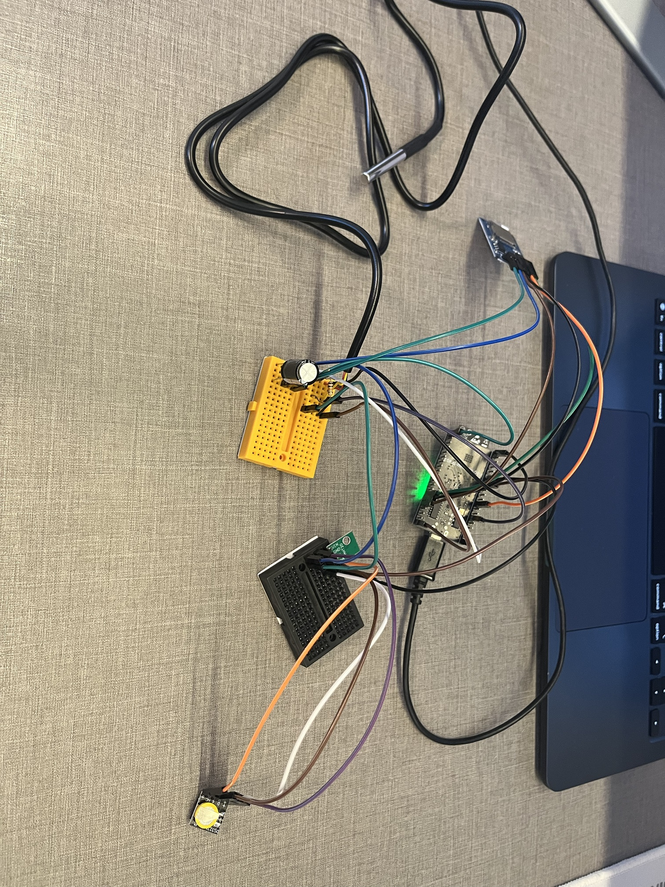

# Station assembly

Parts, wiring, the step-by-step assembly with a test for each module, and the
precautions. The reasons behind each choice are in
[`design-decisions.md`](design-decisions.md).



## Parts

The dollar prices are from international shops (October 2026) and give the cost
in the article, about US$ 60 without the box.

| Qty | Part | ~US$ | Note |
|---|---|---|---|
| 1 | ESP32-WROVER-DEV v1.6 with OV2640 | 12 | Has PSRAM and a USB converter; no card slot |
| 1 | Waterproof DS18B20, stainless steel tip with cable, and a 4.7 kΩ resistor | 2 | Inside sensor; comes sealed |
| 1 | AHT20, I2C module with it alone (no BMP280) | 2 | Outside sensor |
| 1 | DS3231 mini, for Raspberry Pi, with battery | 3 | Clock on I2C; no LED |
| 1 | Common micro SD reader module, with level shifter and regulator | 1 | On SPI and on 5 V |
| 1 | 32 GB microSD card, class 10 | 6 | Up to 32 GB, since larger ones come in exFAT |
| 1 | 1000 µF capacitor | | On the 5 V of the card, against the current peaks of the camera |
| 2 | 170-point mini breadboard and jumpers | 2 | |
| 1 | 6 V solar panel of about 3 W | 10 to 19 | Not built (design) |
| 1 | CN3791 charge controller for a 6 V panel | 5 | Not built; with the battery thermistor input connected |
| 1 | 18650 battery with protection, and holder | 6 | Not built |
| 1 | 5 V boost regulator | 2 | Not built |
| 1 | Box printed in PETG or ASA | | Not built; holes for the lens and the cable |

## Wiring on the ESP32-WROVER-DEV

The camera uses the **WROVER-KIT** pin map (GPIOs 4, 5, 18, 19, 21, 22, 23, 25, 26,
27, 34, 35, 36 and 39); with the AI-Thinker map, used by almost every tutorial, it
does not start. Pins 16 and 17 belong to the PSRAM, and `SD0` to `SD3`, `CMD` and
`CLK` of the header to the internal flash. That leaves 0, 2, 12, 13, 14, 15, 32 and
33; pin 0 is the BOOT button and must be high at boot.

| Function | Pins |
|---|---|
| microSD card over SPI: SCK, MISO, MOSI, CS | 14, 15, 2, 0; supply on 5 V (the board's VCC pin) |
| I2C: SDA and SCL, with the DS3231 (0x68) and the AHT20 (0x38) | 32, 33 |
| DS18B20, 1-Wire | 13, with 4.7 kΩ to 3.3 V |
| Free, only for something that stays low at boot | 12 |

On this board the 5 V pin is called **VCC** and sits at the top right corner, next
to the USB (there is no "5V" pin; VN and VP are signal inputs, never supply).

## The two mini breadboards

Each breadboard has two halves, split by the middle gap. In each half, the five
holes of a column are connected inside, and neighbouring columns do not touch.
There are no `+` and `−` rails. Each column in use is the meeting point of one
signal.

Breadboard 1 holds the DS18B20 in its top half, on 3.3 V, and the 5 V of the card
in its bottom half, away from the 3.3 V. Breadboard 2 holds the AHT20, plugged
straight into columns 1 to 4 of the outer row of its top half, facing out, and
the clock on the same columns, since both share the I2C wires. Two bridges,
male-male jumpers, take the 3.3 V and the GND from breadboard 1 to breadboard 2.

```
   breadboard 1, top:     column 1   column 4   column 7
                            3V3      DS18B20       GND
                                       data
   breadboard 1, bottom:  column 1   column 4
                          VCC (5 V)     GND

   breadboard 2, top:     column 1   column 2   column 3   column 4
                          3V3 (VIN)     GND        SCL        SDA
```

On breadboard 2 the columns are next to each other on purpose: it is the pin
pitch of the AHT20, whose pins (VIN, GND, SCL, SDA) decide what each column is.

## Step by step

Build one module at a time and test it before going to the next: if something
fails, the culprit is the last wire connected. **Unplug the USB cable before
touching any wire.**

The test is `firmware/module_test`. Every 5 s it writes to the serial monitor, at
115200, what the board found. What is not connected yet shows as "not found",
with a hint. The program stays on the board from start to end: plug the USB and
open the serial monitor after each step.

### 0. Before starting

- Upload `firmware/module_test` to the bare board. In the Arduino IDE: board
  "ESP32 Wrover Module", PSRAM "Enabled", Upload Speed 115200. From the terminal,
  in the `beehive-monitoring` folder:

  ```
  arduino-cli compile --fqbn esp32:esp32:esp32wrover firmware/module_test
  arduino-cli upload --fqbn esp32:esp32:esp32wrover --board-options UploadSpeed=115200 \
      -p /dev/cu.usbserial-110 firmware/module_test
  ```

  On the serial monitor the camera already shows `photo of 800x600`, and
  everything else as "not found".
- Solder the four-pin header of the AHT20.
- Copy anything on the card: it will be tested and formatted in FAT32.

### 1. Supply and bridges

| From | To | Jumper |
|---|---|---|
| 3V3 of the board | breadboard 1, top column 1 | female-male |
| GND of the board | breadboard 1, top column 7 | female-male |
| Breadboard 1, top column 1 | breadboard 2, top column 1 (3V3 bridge) | male-male |
| Breadboard 1, top column 7 | breadboard 2, top column 2 (GND bridge) | male-male |

**Test:** the serial monitor stays as in step 0. With a multimeter: 3.3 V between
columns 1 and 7 of breadboard 1 and between columns 1 and 2 of breadboard 2.
Without one, the test of step 3 checks the bridges.

### 2. Inside sensor, waterproof DS18B20

The wires of the sensor used are red (3.3 V), black (GND) and yellow (data). All on
the top half of breadboard 1.

| From | To |
|---|---|
| 4.7 kΩ resistor | one leg on column 1, the other on column 4 |
| Red wire (3.3 V) | column 1 |
| Black wire (GND) | column 7 |
| Yellow wire (data) | column 4 |
| Pin 13 of the board | column 4, female-male |

**Test:** `DS18B20: 1 sensor, 25.31 C`. Hold the steel tip: the temperature rises
within seconds. With "not found", the resistor is off column 4 or the wires are
swapped. **If the sensor heats up, unplug the USB at once:** the wires are
reversed.

### 3. Outside sensor, AHT20

Plug the module straight into the outer row of the top half of breadboard 2,
columns 1 to 4, with the board facing out, without covering the other holes.

| From | To | Jumper |
|---|---|---|
| VIN of the AHT20 | breadboard 2, column 1 | plugged in |
| GND of the AHT20 | breadboard 2, column 2 | plugged in |
| SCL of the AHT20 | breadboard 2, column 3 | plugged in |
| SDA of the AHT20 | breadboard 2, column 4 | plugged in |
| Pin 33 of the board (SCL) | breadboard 2, column 3 | female-male |
| Pin 32 of the board (SDA) | breadboard 2, column 4 | female-male |

Never on 5 V (see "Precautions").

**Test:** `I2C: 0x38` and `AHT20: 25.1 C, 60 % humidity`. Breathe on it: the
humidity rises. With `I2C: nothing`, SDA and SCL are swapped or the 3.3 V is
missing (check the bridges).

### 4. Clock, DS3231 mini

The female header of the module has five holes, marked `+`, `D`, `C`, `NC` and `−`.

| From | To | Jumper |
|---|---|---|
| `+` | breadboard 2, column 1 | male-male |
| `−` | breadboard 2, column 2 | male-male |
| `C` (SCL) | breadboard 2, column 3 | male-male |
| `D` (SDA) | breadboard 2, column 4 | male-male |
| `NC` | nothing | |

**Test:** in the first round, `I2C: 0x38 0x68` and the date and time with `(set now
to the compile time)`; in the next ones, the time moves on without the note. To
test the battery: unplug the USB, wait a minute and plug it again. The time must
still be right and without the note.

### 5. Card reader and capacitor

Both go on the bottom half of breadboard 1, on 5 V.

| From | To | Jumper |
|---|---|---|
| Long leg of the capacitor (+) | bottom column 1 | straight into the hole |
| Leg with the light stripe (−) | bottom column 4 | straight into the hole |
| VCC pin of the board (5 V) | bottom column 1 | female-male |
| Another GND pin of the board | bottom column 4 | female-male |
| VCC of the reader | bottom column 1 | female-male |
| GND of the reader | bottom column 4 | female-male |
| CS of the reader | pin 0 of the board | female-female |
| SCK of the reader | pin 14 | female-female |
| MOSI of the reader | pin 2 | female-female |
| MISO of the reader | pin 15 | female-female |

A reversed capacitor breaks: the light stripe always goes to GND. Put the card in
the reader before plugging the USB.

**Test:** `Card: 31.9 GB, test.jpg written and read back`, with the photo size.
With "not found", the reader is on 3V3 instead of VCC (5 V), MISO and MOSI are
swapped, or the card is not in FAT32.

From here on, to upload a program ("Wrong boot mode" or "Failed to connect"),
remove the wire from pin 2 during the upload and put it back afterwards.

### 6. All together

With everything connected, each round takes a photo and writes it to the card.
Let it run for about five minutes: the round number only grows and no brownout
line appears. On the bench, 56 rounds in a row ran without a reset.

### 7. Station firmware

Upload `firmware/station` (pin 2 wire out, then back in). On the serial monitor,
every 10 s: the time, the photo written to the card and `awake ... ms; sleeps ...
ms`; every 5 min, the environment line. The card gets a folder per day with the
photos, `environment.csv` and `events.txt`.

## Installation

- Camera about 25 cm above the landing board, slightly in front of the entrance,
  with the image covering about 30 to 35 cm of width.
- DS18B20 among the central frames, at the height of the brood nest, with the
  cable coming out through a sealed gap.
- AHT20 outside, in the shade, near the entrance.
- Box in the shade, ventilated, with nothing blocking the entrance.
- At every card retrieval, clean the lens (propolis, webs, condensation) and look
  at the last photo of the day.

## Precautions

- **Card reader.** The common module has a level shifter that passes signals one
  way per wire, and a 3.3 V regulator. So the card goes over SPI, where each wire
  has a single direction. The module goes on 5 V (the VCC pin): on 3.3 V its
  regulator gives the card less than it needs and the card does not answer. The
  regulator draws a few mA all the time, even with the board asleep. The module
  also holds MISO driven, so MISO cannot go on pin 12, which stops the board from
  booting, nor on pin 0. The module holds pin 2 (MOSI) high, which blocks uploads.
- **DS3231 mini.** The Raspberry Pi module already has a battery and no LED, which
  would weigh on the sleep consumption.
- **DS18B20 wires.** The colours change between makers; check them before
  connecting. Reversed, it heats up and burns.
- **AHT20 on 3V3.** The green module has a regulator and accepts 5 V, but the
  pull-ups of its data lines go to the input voltage: on 5 V it would put 5 V on
  the I2C of the ESP32, which only stands 3.3 V.
- **GPIO 12** sets the flash voltage at boot: with a pull-up, the board does not
  start.
- **USB cable** that only charges does not upload.
